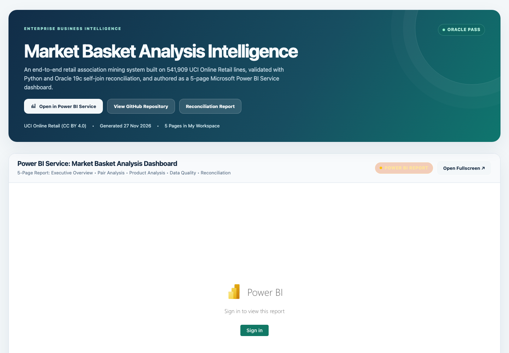

# Market Basket Analysis for Retail Transactions

This project analyzes retail invoice baskets with transparent Python association metrics, an Oracle SQL self-join implementation, and a Power BI dashboard specification. It is built around the public UCI **Online Retail** dataset and is designed to be rerun from the command line.

Published repository: [github.com/krishporwal011/Bussiness-BI](https://github.com/krishporwal011/Bussiness-BI), branch `main`.

## Business problem

Retail teams want to identify products that co-occur in the same transaction so they can test bundles, merchandising adjacency, and “frequently bought together” recommendations. The project reports the top 10 unordered item pairs by pair count and a supplementary top 10 by lift, including support, confidence A → B, confidence B → A, and lift.

## Current result

The UCI workbook contains 541,909 raw invoice lines. With the default rules, the pipeline retains 522,537 valid merchandise lines, 19,773 baskets, 3,798 products, 517,287 distinct basket-item rows, and 1,500 single-item baskets. The count-ranked top pair is `JUMBO BAG PINK POLKADOT + JUMBO BAG RED RETROSPOT` with 825 baskets, support 0.041724, directional confidence 0.6773 / 0.3949, and lift 6.4112. The lift-ranked top pair is `PINK KNITTED EGG COSY + BLUE KNITTED EGG COSY` with 25 baskets and lift 608.7746; its low pair count is why lift is shown separately from count.

See [reports/insights_summary.md](reports/insights_summary.md) for the full generated tables and observed-fact/recommendation separation.

## Streamlit dashboard (primary public dashboard)

A native **Streamlit + Plotly** dashboard now replaces the Power BI embed as the primary public dashboard. It opens directly in the browser: **no Microsoft sign-in, Power BI licence, Oracle connection, or raw UCI workbook is needed.** It reads only files already committed to this repository.

- **Dashboard URL:** `https://<your-app-name>.streamlit.app` _(placeholder: replace after deploying; see below)_
- **Main file path for deployment:** `streamlit_app/app.py`
- **Dependencies:** [`streamlit_app/requirements.txt`](streamlit_app/requirements.txt) (Streamlit, Plotly, pandas, NumPy, openpyxl only)

### Features

| Section | What it shows |
|---|---|
| Executive Overview | Headline KPI cards, top pair by count and by lift, monthly baskets and revenue, top products, baskets by country, Oracle/Python reconciliation status |
| Transaction & Basket KPIs | Average/median basket size, single-item share, basket value, basket-size distribution, monthly trend, country table (country and date filters) |
| Product Analysis | Rank products by baskets, units or revenue; frequency tiers; frequency-vs-revenue scatter; searchable product table; rare-item toggle |
| Top 10 Frequent Item Pairs | Count-ranked pairs with support, both confidences and lift; cross-checked against `outputs/python_top_10_pairs.csv` |
| Top 10 Pairs by Lift | Lift-ranked pairs shown with their (small) pair counts; cross-checked against `outputs/python_lift_top_10_pairs.csv` |
| Support & Confidence | Support and lift distributions, A→B vs B→A confidence scatter, directional rules table |
| Interactive Pair Analysis | Pick an anchor product, rank its partners, open any pair for the 2×2 basket breakdown and observed-vs-expected co-occurrence |
| Data Quality Overview | Raw-to-retained bridge, primary exclusion reasons, quality flags, rare-item impact, reconciliation result, live formula checks over all 347,481 pairs |

**Sidebar filters** (apply to the pair-based sections): product (multi-select, either/both items), pair search, minimum pair count, minimum support, minimum lift, minimum confidence (both directions), and a Reset button. The basket page has its own country and date filters. Charts and tables are interactive, and the app follows the viewer's light/dark theme.

**Data accuracy.** No metric is computed from assumptions or invented. Pair metrics come from `outputs/python_pair_metrics.csv`; headline KPIs, product revenue/quantity, basket summaries and data-quality counts come from `powerbi/market_basket_dashboard_data.xlsx` (itself generated from the Python outputs), with `dashboard/data/dashboard_data.json` as a KPI fallback. Ranking and filtering reuse the documented rules in [docs/kpi_definitions.md](docs/kpi_definitions.md). The pipeline and Oracle SQL are unchanged. If a file is missing the app degrades gracefully (full pair table → 200-pair workbook subset → top-10 CSVs) and says which source it is using.

### Run locally

From the repository root:

```bash
python3 -m venv .venv && source .venv/bin/activate
python -m pip install -r streamlit_app/requirements.txt
streamlit run streamlit_app/app.py
```

Then open <http://localhost:8501>. All paths are resolved relative to the repository root, so it can be started from any directory.

### Deploy on Streamlit Community Cloud

1. Push the `streamlit_app/` folder, `.streamlit/config.toml` and the updated `README.md` to the `main` branch of `krishporwal011/Bussiness-BI`. Make sure `outputs/python_pair_metrics.csv` is still tracked (it is matched by `.gitignore` but force-tracked; check with `git ls-files outputs/python_pair_metrics.csv`).
2. Go to [share.streamlit.io](https://share.streamlit.io) and sign in with GitHub, then choose **Create app → Deploy a public app from GitHub**.
3. Repository: `krishporwal011/Bussiness-BI` · Branch: `main` · **Main file path: `streamlit_app/app.py`**.
4. Under **Advanced settings** pick Python 3.11 or newer (3.12 is fine). Streamlit Cloud installs `streamlit_app/requirements.txt` because it sits next to the main file. No secrets are required.
5. Click **Deploy**, wait for the build, then copy the `*.streamlit.app` URL into the placeholder above.

> The repository root also contains an older `app.py` that only embeds the Power BI report. It is kept for history and is **not** the dashboard; always deploy `streamlit_app/app.py`.

## Dataset source and license

- Dataset: UCI Online Retail.
- Official source: [UCI dataset record](https://archive.ics.uci.edu/dataset/352/online%2Bretail).
- Citation: Chen, D. (2015). Online Retail. UCI Machine Learning Repository. [DOI 10.24432/C5BW33](https://doi.org/10.24432/C5BW33).
- Download date: 2026-11-26.
- License: CC BY 4.0; retain attribution for redistributed or adapted work.
- Raw file: `data/raw/Online Retail.xlsx`; it is preserved locally and ignored by Git.

The research rationale and citations are in [docs/research_report.md](docs/research_report.md).

## Folder structure

```text
config/       Thresholds and dataset configuration
data/raw/     Unmodified source workbook (local, ignored)
data/cleaned/ Clean transaction, presence, basket, product, and quality tables
data/derived/ Normalized SQL staging CSV (local, ignored)
dashboard/    Static GitHub Pages dashboard and browser data bundle (historical/optional)
docs/         Research, KPI definitions, and data-model diagram
notebooks/    Cleaning and association-analysis walkthroughs
outputs/      Python pair metrics, top-10 outputs, frequency and impact tables
powerbi/      Power Query, DAX, model, and dashboard build specification
reports/      Data quality, insights, and SQL/Python reconciliation reports
sql/          Oracle 19c-compatible schema, load, transform, views, and validation
src/          Command-line cleaning, analysis, and reconciliation programs
streamlit_app/ Streamlit + Plotly dashboard (primary public dashboard) and its requirements.txt
.streamlit/   Streamlit theme/server config
tests/        Automated unit tests for pair grain and denominator behavior
```

## Environment setup

Python 3.10+ is recommended.

```bash
python3 -m venv .venv
source .venv/bin/activate
python -m pip install --upgrade pip
python -m pip install -r requirements.txt
```

The downloaded workbook is already present in this workspace. For a fresh clone, download `Online Retail.xlsx` from the official UCI record into `data/raw/` and keep the raw file unchanged.

## Run the Python pipeline

From the project root:

```bash
python src/clean_data.py
python src/market_basket_analysis.py
python src/reconcile_sql_python.py
```

Outputs:

- `data/cleaned/cleaned_transaction_lines.csv`
- `data/cleaned/basket_item_presence.csv`
- `data/cleaned/basket_summary.csv`
- `data/cleaned/product_summary.csv`
- `data/cleaned/data_quality_summary.csv`
- `data/cleaned/cleaning_audit.csv`
- `reports/data_quality_report.md`
- `outputs/python_pair_metrics.csv`
- `outputs/python_top_10_pairs.csv`
- `outputs/python_lift_top_10_pairs.csv`
- `outputs/python_item_frequency.csv`
- `outputs/rare_item_impact.csv`

The full `outputs/python_pair_metrics.csv` is tracked because it is a required project output; it is approximately 54 MB. Raw, staging, and large cleaned extracts remain ignored and are regenerated from the documented UCI source.

The primary implementation is intentionally transparent: it deduplicates to one row per basket-item, uses `itertools.combinations` to generate unordered pairs inside each basket, counts baskets, and computes the documented formulas. It does not rely on `mlxtend`; the research report links to mlxtend for independent metric definitions.

## Threshold configuration

Edit `config/analysis_config.json` before rerunning both Python and Oracle:

```json
{
  "min_item_frequency": 5,
  "min_pair_count": 20,
  "min_support": 0.001,
  "min_confidence": 0.0,
  "top_n": 10,
  "include_canceled_returns": false
}
```

The cleaned dataset preserves all valid merchandise products. The minimum item frequency affects pair generation only and the impact is written to `outputs/rare_item_impact.csv`. The default count/support thresholds make the full pair CSV manageable and reduce unstable lift-only results; they are not hard-coded in the source.

## Data-cleaning rules

The raw workbook is never edited. The pipeline standardizes column names, trims and upper-cases keys/names, parses numbers and dates safely, flags cancellations/returns, invalid quantities/prices, missing basket/item/name/date values, known service/adjustment codes, test rows, and exact duplicates, and records primary exclusion counts. Missing customer IDs are retained when the basket-item data is valid. Quantity, line count, and revenue are kept separately from binary presence.

Single-item baskets are kept in the basket population and support denominator; they simply create no pair. Exact duplicates are removed once before the clean-line output. Association counts are computed from the unique basket-item presence table, so repeated lines for the same item cannot inflate pair counts.

See [docs/kpi_definitions.md](docs/kpi_definitions.md) and [reports/data_quality_report.md](reports/data_quality_report.md).

## Oracle setup and execution

Oracle reconciliation was completed on 2026-11-27 in GitHub Actions run [45988078788](https://github.com/krishporwal011/Bussiness-BI/actions/runs/45988078788) on the standard `ubuntu-latest` runner. The workflow uses the public Docker Hub `gvenzl/oracle-free:full` image, an ephemeral masked password, and no Oracle Cloud, Oracle Container Registry login, paid service, or local Mac Docker storage.

Run in this order in a target Oracle 19c-compatible schema:

```text
@sql/01_create_schema.sql
@sql/02_create_tables.sql
-- load data/derived/sql_staging.csv with sql/stg_transaction_line.ctl
@sql/04_load_staging.sql
@sql/05_transform_clean.sql
@sql/03_create_constraints_indexes.sql
@sql/07_create_views.sql
@sql/06_pair_queries.sql
@sql/08_validation_reconciliation.sql
```

The pair query uses `SELECT DISTINCT` basket-item keys, item-frequency filtering, a self-join on basket ID, `item_a_key < item_b_key`, exact distinct basket counts, and the `FACT_TRANSACTION` basket denominator. Views include `VW_BASKET_SUMMARY`, `VW_ITEM_FREQUENCY`, `VW_ITEM_PAIR_METRICS`, `VW_TOP_10_ITEM_PAIRS`, and `VW_DATA_QUALITY_SUMMARY`. Full details are in [sql/README.md](sql/README.md).

Validation prerequisites are Oracle 19c/Free/XE (or an approved Oracle service), SQL*Plus or SQLcl, SQL*Loader, schema DDL/view/index privileges, and a regenerated `data/derived/sql_staging.csv`. Use an interactive connection or wallet; never place a password in a command or repository. The exact validation checklist is in [sql/README.md](sql/README.md).

## SQL/Python reconciliation

The reconciler compares pair keys, pair counts, basket counts, both item counts, support, both directional confidences, and lift. Integer counts must match exactly; floating metrics use an absolute tolerance of `1e-9`. Missing and extra pair keys are reported, and any mismatch causes a non-zero exit code.

Current status: **PASS**. Oracle produced the real [pair metrics export](outputs/oracle_pair_metrics.csv), and the [reconciliation report](reports/sql_python_reconciliation.md) compared 347,481 pair keys: 347,481 matched and 0 failed. The workflow fails on missing, extra, or mismatched pairs; floating metrics retain the existing absolute tolerance of `1e-9`.

```bash
python src/reconcile_sql_python.py \
  --python outputs/python_pair_metrics.csv \
  --sql oracle_exports/oracle_pair_metrics.csv
```

## Historical dashboard: GitHub Pages and Power BI embed

_Superseded by the [Streamlit dashboard](#streamlit-dashboard-primary-public-dashboard) above, which needs no Microsoft sign-in. The GitHub Pages site and Power BI material below are preserved unchanged as historical/optional components._

The live demo is available at [krishporwal011.github.io/Bussiness-BI](https://krishporwal011.github.io/Bussiness-BI/).

### Demo links

- **GitHub Pages live dashboard:** [Open live demo](https://krishporwal011.github.io/Bussiness-BI/)
- **Power BI Service report:** [Open Market Basket Analysis Dashboard](https://app.powerbi.com/groups/me/reports/f3b6d1a8-4352-48ce-ac15-9ac82f37b844/a361debbb237bbac3100?experience=power-bi)
- **Reconciliation evidence:** [Open SQL/Python reconciliation report](reports/sql_python_reconciliation.md)
- **Latest Pages deployment:** [Successful GitHub Actions run](https://github.com/krishporwal011/Bussiness-BI/actions/runs/46138119984)

The GitHub Pages site is an interactive static dashboard built from the verified Python outputs and Oracle reconciliation status. Its primary report card uses Power BI's secure `reportEmbed` endpoint and opens the five-page Power BI Service report for signed-in users with report permission. Anonymous visitors see Microsoft's sign-in prompt because the current ABES tenant has not enabled **Publish to web**. This is an access-policy limitation, not a missing or fabricated embed URL.



_Live screenshot captured from the deployed GitHub Pages URL on 2026-11-28. The screenshot shows the Power BI Service embed and the sign-in requirement; the verified interactive fallback metrics continue below the report card._

The deployment workflow is [`.github/workflows/pages.yml`](.github/workflows/pages.yml), and the dashboard source is [`dashboard/index.html`](dashboard/index.html).

This browser dashboard is the deliverable for the current macOS workflow. It is not a `.pbix` file and does not require Power BI Desktop.

## Power BI dashboard specification

Power BI Desktop remains an optional Windows-only build path; no `.pbix` file is claimed for this macOS project. The complete specification is in [powerbi/README.md](powerbi/README.md), with [Power Query M](powerbi/power_query.m), [DAX measures](powerbi/dax_measures.dax), and [relationship guidance](powerbi/model_relationships.md). The GitHub Pages dashboard above is the live cross-platform alternative.

Required pages:

1. Executive overview — KPI cards, trend, frequent items, top pair.
2. Pair analysis — Item A/B/date/customer/country slicers, pair matrix, conditional formatting, count/lift views.
3. Item analysis — item frequency, support, quantity/revenue, rare-item diagnostics.
4. Data quality — raw/retained/removed/duplicate/missing/return/singleton/rare-item metrics.
5. Pair detail — drill-through to supporting baskets, dates, customer/country, and co-purchased items.

## KPI formulas

The full dictionary is in [docs/kpi_definitions.md](docs/kpi_definitions.md). In short:

```text
support(A,B)       = pair_count(A,B) / eligible_basket_count
confidence(A -> B) = pair_count(A,B) / basket_count(A)
confidence(B -> A) = pair_count(A,B) / basket_count(B)
lift(A,B)          = support(A,B) / (support(A) * support(B))
```

Pairs are stored once with `item_a_key < item_b_key`; lift is symmetric, confidence is directional.

## Tests and validation

```bash
python -m pytest -q
python -m json.tool notebooks/01_cleaning_and_quality.ipynb >/dev/null
python -m json.tool notebooks/02_association_rules.ipynb >/dev/null
```

The unit tests verify that duplicate lines do not inflate a pair and that a single-item basket remains in the support denominator. The notebooks are executable walkthroughs of the two Python stages.

The final audit is in [reports/final_submission_checklist.md](reports/final_submission_checklist.md). The pipeline suite has 5 passing tests, including threshold behavior, formula checks, deterministic ordering, no reverse-pair duplication, and visible reconciliation failure behavior. `tests/test_streamlit_dashboard.py` adds 31 dashboard tests (KPI values and top-10 tables versus the committed outputs, formula integrity over all pairs, filters and empty results, missing-file fallbacks, deployment-safety checks, and every page rendered through Streamlit's `AppTest`). The UI tests skip automatically unless `pip install -r streamlit_app/requirements.txt` has been run.

## GitHub publication

The project is published at the repository root on the authorized `main` branch. GitHub accepted the approximately 54 MB `outputs/python_pair_metrics.csv` file with a large-file recommendation warning; raw data and bulk staging/cleaned extracts remain excluded and reproducible.

## Known limitations and remaining user action

- The dataset is one historical retailer and should not be treated as causal or universally representative.
- A fresh clone must obtain the public raw workbook separately because the raw file, SQL staging extract, and bulk cleaned CSVs are ignored by Git. The required full pair-metrics CSV is included despite its size; the remaining generated extracts can be regenerated with the Python commands above.
- The local Git repository is initialized on `main`, tracks `origin/main`, and is published at the repository URL shown above.

